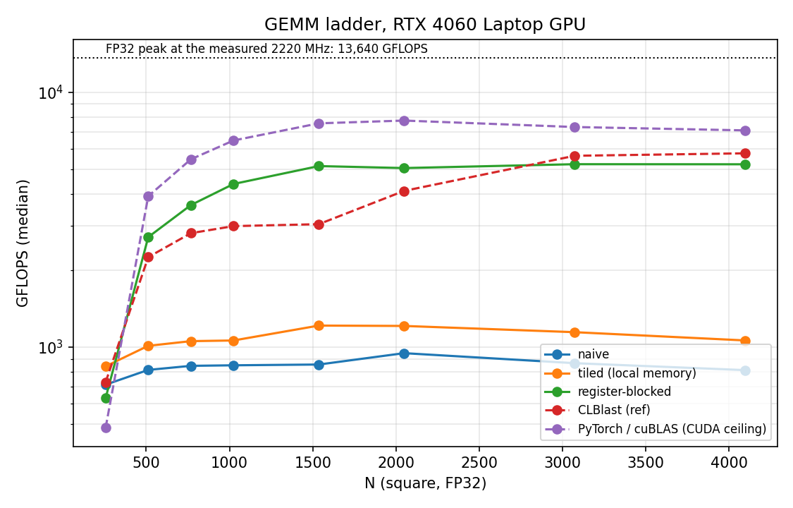
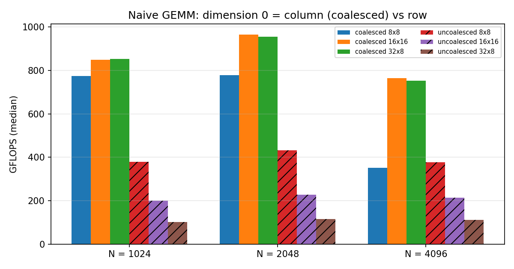
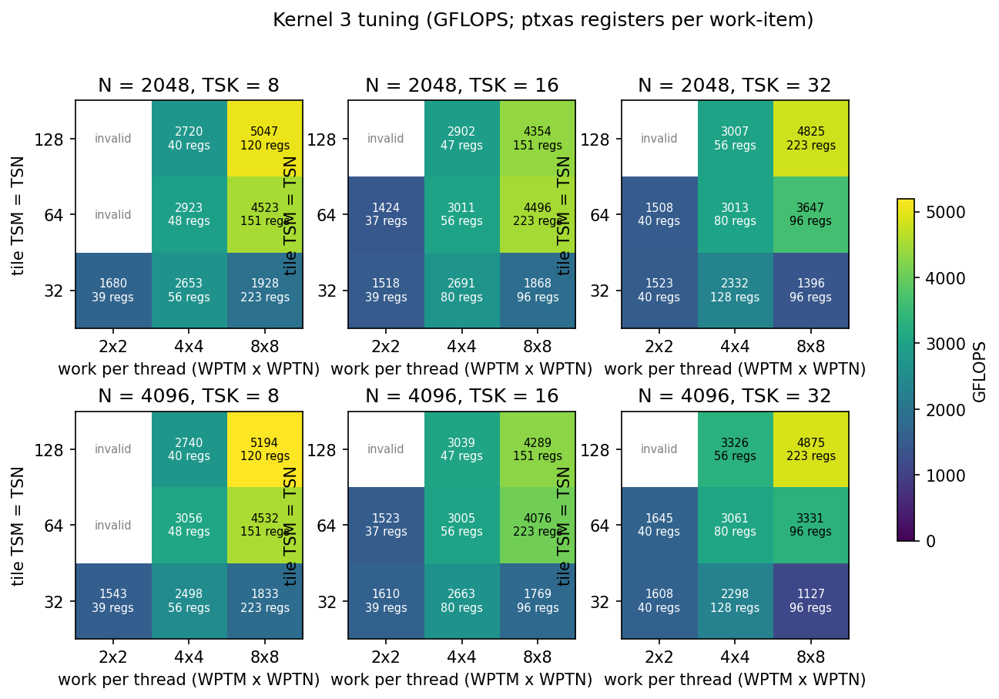
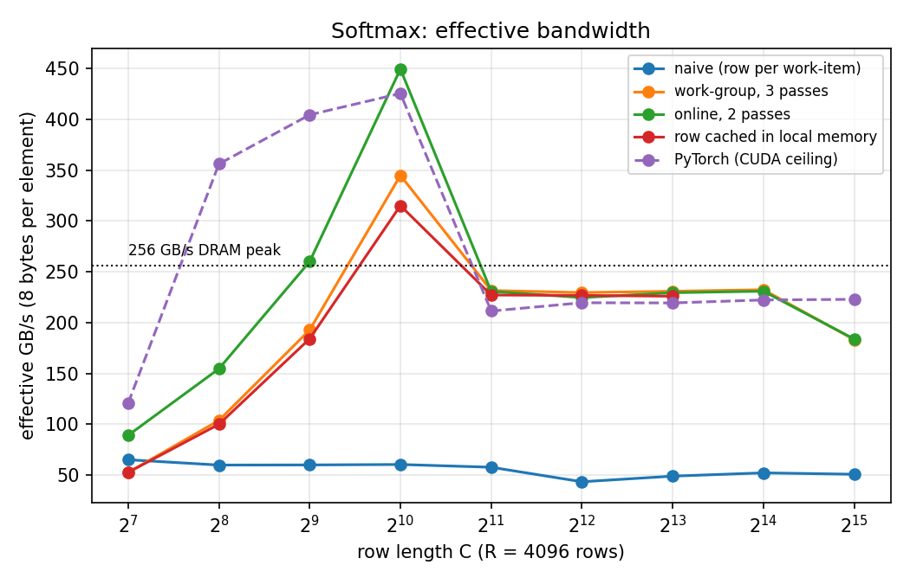
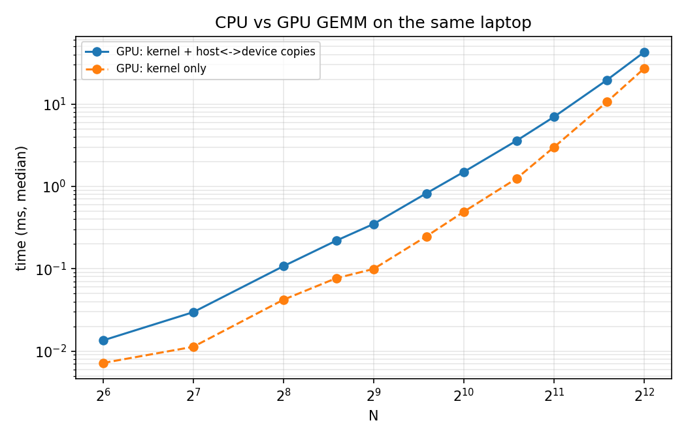
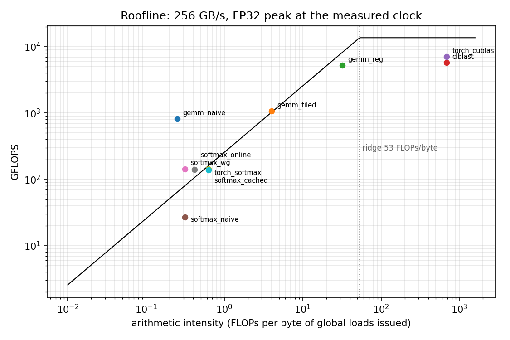
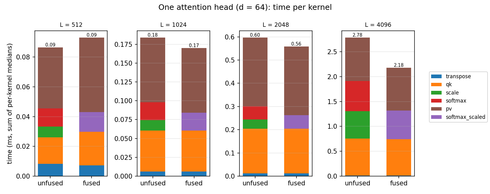

# ClKernels

[](https://github.com/Varshith-06/matmul-gpu/actions/workflows/ci.yml)

FP32 GEMM and softmax in OpenCL on an RTX 4060 Laptop GPU, each taken from a naive kernel to an optimized one and explained with measurements. GEMM goes from **813 GFLOPS** (naive) to **5,220 GFLOPS** at N = 4096: **38% of FP32 peak** at the measured 2,220 MHz clock, **91% of CLBlast** and **74% of cuBLAS**. Softmax runs at **230 GB/s, 90% of the 256 GB/s memory roofline**. Fusing the scale pass into softmax makes one attention head **22% faster** at L = 4096.

This is the GPU sequel to [CacheMatmul](https://github.com/Varshith-06/matmul-cpu): the same operation, the same testing rules, a different machine model. Every number below comes from a CSV in [`results/`](results/) and can be regenerated with the commands in [Reproduce](#reproduce).

## Machine

| | |
|---|---|
| Laptop | HP OMEN 16-xd0xxx, on AC power, Windows "Balanced" power plan |
| GPU | NVIDIA GeForce RTX 4060 Laptop GPU (Ada, AD107): 24 SMs × 128 FP32 lanes = 3,072 lanes; 8 GB GDDR6, 128-bit, 256 GB/s |
| Driver | 616.92, OpenCL 3.0 CUDA 13.4.89; kernels compiled as OpenCL C 1.2 (`-cl-std=CL1.2`) |
| Device limits | 48 KB local memory per work-group, 1,024 work-items per group ([`devices.txt`](results/devices.txt)) |
| Host | AMD Ryzen 7 7840HS, Windows 11; MSVC 19.51 (VS Build Tools 2026), CMake `Release` |
| Clocks | Median SM clock while the GEMM ladder ran: **2,220 MHz** (min 2,085), at a median **86 °C** ([`clocks_summary.md`](results/clocks_summary.md)) |
| Method | GPU-side profiling-event times, one warm-up launch then 20 timed launches, **median** reported; copies timed separately; every configuration checked against a double-precision CPU reference before its time is reported |

`bench --devices` lists two OpenCL platforms on this laptop: the RTX 4060 and the Ryzen's integrated Radeon 780M (`gfx1103`). The harness picks devices by name, never "the first GPU".

**Peak, computed rather than quoted.** Each lane does one FMA (2 FLOPs) per cycle: 3,072 × 2 × 2.22 GHz = **13,640 GFLOPS** during the ladder. The clock moved between experiments (medians of 2,220–2,565 MHz and 61–86 °C, peaking at 89 °C), so each "% of peak" below uses the clock logged during that experiment. Laptop clocks follow temperature: the GEMM runs were the hottest and slowest-clocked.

**Ridge point.** 13,640 GFLOPS / 256 GB/s ≈ **53 FLOPs per byte**. Large GEMM can sit above it and be compute-bound. Softmax does about 5 FLOPs per 8 bytes, far below it, so it is judged in GB/s.

**Repeatability.** I ran the whole tuning and experiment grid a second time with the laptop in OMEN's performance mode ([`results/rerun_performance_mode/`](results/rerun_performance_mode/)). The median change across all configurations was below 1%. The headline kernel moved from 5,220 to 5,185 GFLOPS, the tuning picked the same best configuration, and softmax and layer norm agreed within 1% at 4096 columns. The larger differences were 5–13% for the naive kernels and a few tuning points, and much more for the attention kernels at L = 512, which last only a few microseconds. Performance mode raised the power ceiling (peak draw 97 → 107 W, and NVIDIA's power-cap flag disappeared). But the GPU then hit its thermal limit at 86–88 °C, so the median clock during the GEMM ladder rose only from 2,220 to 2,325 MHz. The OpenCL kernels did not get faster. cuBLAS gained 5–9%, which would make `gemm_reg` 70% of cuBLAS instead of 74%. The headline numbers here come from the first run.

## Headline results

N = 4096 for GEMM, 4096 × 4096 for softmax. Times are GPU-event medians without host↔device copies. CLBlast is timed on the host around the whole call (see [below](#reference-ceilings)).

| Kernel | N or shape | Time (ms) | GFLOPS | GB/s | % of peak | Registers |
|---|---|---:|---:|---:|---:|---:|
| gemm_naive (16 × 16) | 4096 | 169.15 | 813 | | 6.0% | 40 |
| gemm_tiled (TS = 16) | 4096 | 129.35 | 1,063 | | 7.8% | 37 |
| gemm_reg (128 × 128 tile, TSK = 8, 8 × 8 per work-item) | 4096 | 26.33 | **5,220** | | **38.3%** | 120 |
| CLBlast 1.7.0 SGEMM (ref) | 4096 | 23.84 | 5,764 | | 42.3% | – |
| PyTorch 2.13 / cuBLAS, TF32 off (CUDA ceiling) | 4096 | 19.38 | 7,092 | | 51.3% | – |
| softmax_wg (WG = 256) | 4096 × 4096 | 0.585 | – | **230** | 90% of 256 | 32 |
| softmax_online (WG = 256) | 4096 × 4096 | 0.598 | – | 225 | 88% of 256 | 34 |



The register-blocked kernel beats CLBlast's default tuning from N = 512 to 2048. At N = 2048 it is 23% faster (5,045 vs 4,104 GFLOPS). CLBlast pulls ahead from N = 3072. cuBLAS stays 1.36–1.54× ahead from N = 512 up. The [last section](#the-gap-to-cublas) explains why.

## GEMM, step by step

### 1. Naive: 813–966 GFLOPS, and the coalescing experiment

One work-item per element of C ([`kernels/gemm.cl`](kernels/gemm.cl)). Dimension 0 (`get_global_id(0)`) varies fastest within a warp, so it indexes **columns**. A warp's 32 loads of `B[k][col]` are then 128 contiguous bytes, its `A[row][k]` load is one broadcast address, and its stores to C are contiguous.

Each work-item reads 2N floats to do 2N FLOPs: 0.25 FLOPs per byte. If every load went to DRAM, the kernel could reach at most 256 GB/s × 0.25 = **64 GFLOPS**. It measures **813 at N = 4096**, nearly 13× that. The difference is reuse that the code never asked for: neighbouring warps reread the same rows of A and columns of B, the L2 cache (tens of MB on AD107; sources give 24–32 MB) serves most of those rereads, and the A load is a broadcast.

`gemm_naive_bad` is identical except that the two indices are swapped. Same arithmetic, same answer:

| N | Local size | Coalesced (GFLOPS) | Uncoalesced (GFLOPS) | Ratio |
|---|---|---:|---:|---:|
| 2048 | 8 × 8 | 778 | 433 | 1.8× |
| 2048 | 16 × 16 | 966 | 228 | 4.2× |
| 2048 | 32 × 8 | 956 | 117 | **8.2×** |
| 4096 | 16 × 16 | 765 | 215 | 3.6× |
| 4096 | 32 × 8 | 752 | 112 | 6.7× |



The ratio tracks how many **distinct rows** one warp touches in the bad kernel: 8 with an 8 × 8 group, 16 with 16 × 16, and 32 with 32 × 8. Each distinct row costs a separate memory transaction for A and another for the store to C. This is the CPU loop-order lesson again (access order beats arithmetic): CacheMatmul measured 78× between i-j-k and i-k-j on a CPU. Here the gap is 8× on a GPU.

**Not yet explained:** the *coalesced* kernel with 8 × 8 groups falls from 778 GFLOPS at N = 2048 to 351 at N = 4096, while 16 × 16 and 32 × 8 hold at about 760. An 8-wide group reads B in 32-byte pieces from four rows that are 16 KB apart. My guess is that these accesses pile up on a few DRAM channels or L2 slices at this stride, but I have no counters to confirm it (see [Limitations](#limitations)).

### 2. Local-memory tiling: 1.3× over naive, and why only that

Each TS × TS work-group loads one tile of A and one of B into `__local` memory and reuses each value TS times. That cuts global traffic by a factor of TS. Two barriers per tile step:
- **After the load** (read-after-write): no work-item may read a tile slot before its owner has written it.
- **After the compute** (write-after-read): a fast work-item must not overwrite the tile for step t + 1 while a slow one is still reading step t.

No work-item returns early. A work-item past the matrix edge loads a zero and still reaches both barriers. The tests at N = 15–17, 31–33, 63–65 and 127–129 exist for exactly that zero-padding.

| TS | N = 512 | N = 2048 | N = 4096 | Registers |
|---|---:|---:|---:|---:|
| 8 | 755 | 885 | 643 | 40 |
| 16 | **1,028** | **1,071** | 1,051 | 37 |
| 32 | 993 | 1,061 | **1,053** | 39 |

([`exp1_tiled_ts.csv`](results/exp1_tiled_ts.csv), [plot](results/exp1_tiled_ts.png))

Tiling buys only about 1.3× over naive, for two reasons. First, the naive kernel already gets much of this reuse from L2. Second, the tiled inner loop does **two local-memory loads per FMA**. The PTX confirms it: 32 `ld.shared.f32` against 16 `fma.rn.f32` in the unrolled TS = 16 loop ([`gemm_tiled_ts16.ptx`](results/ptx/gemm_tiled_ts16.ptx)). That makes this kernel bound by local-memory bandwidth, not arithmetic. TS = 32 doubles reuse, but its 1,024-work-item groups allow only one group per SM (the SM limit is 1,536 work-items), against six 256-item groups at TS = 16. The two effects cancel, which is why TS = 16 and TS = 32 tie.

### 3. 2D register blocking: 5,220 GFLOPS

Each work-item holds a WPTM × WPTN block of C in registers. Per inner step it loads WPTM values of A and WPTN of B from local memory and does WPTM × WPTN FMAs. At 8 × 8 that is **16 local loads for 64 FMAs, 0.25 per FMA instead of 2**. The PTX of the winning configuration shows exactly that block: 16 `ld.shared.f32` and 64 `fma.rn.f32`, with no `ld.local`/`st.local` spills ([`gemm_reg_128x128_k8_8x8.ptx`](results/ptx/gemm_reg_128x128_k8_8x8.ptx)):

```
ld.shared.f32  %f409, [%rd98+-256];      // a value of A from the local tile
ld.shared.f32  %f410, [%rd99+-2048];     // a value of B
fma.rn.f32     %f544, %f410, %f409, %f544;
ld.shared.f32  %f411, [%rd98+-192];
fma.rn.f32     %f543, %f410, %f411, %f543;
...                                      // 64 FMAs per k step; the m and n loops are fully unrolled
```

The TSK loop (eight k steps) stays a loop in the PTX. The WPTM × WPTN loops are unrolled because they are `-D` constants.

**Tuning.** [`scripts/tune.py`](scripts/tune.py) ran 54 grid points: tile TSM = TSN ∈ {32, 64, 128}, TSK ∈ {8, 16, 32} and work per thread ∈ {2, 4, 8}², at N = 2048 and 4096. Eight points break the kernel's divisibility rules or the 1,024-work-item limit. The host rejects those before launch.



The heatmap has a clear ridge. Its left side is bound by local-memory loads, its right side by occupancy:
- **2 × 2 per work-item stays at 1,400–1,700 GFLOPS** at every tile size. With 1 local load per FMA, local memory is still the bottleneck.
- **4 × 4 roughly doubles that** (2,300–3,300).
- **8 × 8 with a big tile wins (5,194)**, but only while registers allow enough warps per SM. Ada has 65,536 registers per SM. At 120 registers per work-item, a 256-item group needs 30,720, so **two groups (512 work-items, a third of the 1,536 maximum) fit**. TSK = 16 raises the count to 151, so only **one** group fits, and throughput drops to 4,289. TSK = 32 needs 223 registers: 4,875 (1 group).
- **A small tile with 8 × 8 is the worst corner** (32 × 32 tile, 4 × 4 = 16 work-items per group): 1,127–1,928 GFLOPS. Each group holds only half a warp, so the SM never has enough warps to hide latency.

No configuration spilled (`spill_bytes` = 0 everywhere). On this GPU the right edge of the ridge comes from occupancy, not from spills.

**Ownership layout.** The kernel gives each work-item a *strided* block: consecutive work-items own consecutive columns (`tx + n * RTSN`). The alternative, a contiguous block per work-item (`tx * WPTN + n`, built with `-DCONTIG=1`), makes a warp's reads of `Bs` 8 floats apart. That causes bank conflicts in local memory and turns the final stores to C into strided writes:

| Config | Strided (GFLOPS) | Contiguous (GFLOPS) | Loss |
|---|---:|---:|---:|
| 64 × 64, TSK 16, 4 × 4 | 2,934 | 2,876 | 2% |
| 128 × 128, TSK 8, 8 × 8 | 5,036 | 3,743 | **26%** |

([`exp3_ownership.csv`](results/exp3_ownership.csv), N = 4096.) The loss grows with WPTN because the read stride does.

### Reference ceilings

- **CLBlast 1.7.0**, built from source with its default (untuned) parameters; I did not run its tuner. The event CLBlast returns covers only its last internal kernel, which made N = 4096 look like 281 TFLOPS. CLBlast is therefore timed on the host from an idle queue to `finish()`. That includes a few tens of microseconds of launch overhead, which only matters at small N.
- **PyTorch 2.13 on CUDA 12.6 (cuBLAS)**, `allow_tf32 = False`, so it is true FP32 like the OpenCL kernels ([`reference/torch_ref.py`](reference/torch_ref.py)). It is CUDA, not OpenCL: a **ceiling**, not a competitor. It peaks at 7,749 GFLOPS (N = 2048), 56% of the FP32 peak at its 2,250 MHz median clock.

## Softmax, step by step

Every variant computes yⱼ = exp(xⱼ − m) / Σ exp(xₖ − m) per row, with m the row maximum. Subtracting m keeps `exp` from overflowing (the tests feed it values near 1,000). Effective bandwidth counts only the 8 bytes per element that must move (read x once, write y once), so 256 GB/s is the best possible number.

| Variant | Global reads of x | Writes of y | Bytes per element |
|---|---|---|---:|
| naive (one work-item per row) | 3 | 1 | 16 |
| work-group per row, tree reductions | 3 | 1 | 16 |
| online (max and sum in one pass) | 2 | 1 | 12 |
| row cached in local memory | 1 | 1 | 8 |



R = 4,096 rows, row length C from 128 to 32,768 ([`exp4_softmax.csv`](results/exp4_softmax.csv)):
- **Naive: 43–65 GB/s at every C.** Neighbouring work-items read addresses C floats apart, so no load is coalesced.
- **From C = 2,048 to 16,384, the work-group, online and cached variants all run at 225–232 GB/s, 88–91% of 256.** That is the memory roofline. PyTorch's softmax measures 211–223 GB/s at the same sizes.
- **They tie because the extra reads never reach DRAM.** A row is 8–64 KB. When pass 2 rereads the row that pass 1 just read, the data is still in cache. Saving a pass therefore only pays off when the row cannot stay cached. That is the situation in attention, where online softmax (FlashAttention) combines tiles that are never stored whole.
- **Below C = 2,048 the numbers go past 256 GB/s** (450 GB/s for online at C = 1,024). Those inputs are 16 MB or less, so they stay in L2 between repetitions: this measures L2, not DRAM. PyTorch shows the same jump (426 GB/s).
- **The cached variant** fits rows up to about 12,000 floats in 48 KB of local memory. The host refuses larger C ("use softmax_online"). On this GPU it gains nothing, for the same caching reason.

**Work-group size** ([plot](results/exp4_softmax_wg.png)). For long rows (C = 32,768), WG = 256 reaches 183 GB/s and WG ≥ 512 reaches 228–230. For short rows (C = 1,024), WG = 1,024 collapses to 62–98 GB/s. Each work-item then handles one element, and the ten barrier-separated reduction steps dominate. WG = 64–128 is fastest at that size.

**Online softmax's NaN guard.** When C < WG, some work-items see no elements, and their partial (max, sum) is (−∞, 0). Combining two such pairs computes exp(−∞ − (−∞)) = NaN. The combine step therefore returns sum 0 when both maxima are −∞. The tests cover C = 1, 7 and 100 with WG = 256.

**Layer norm** runs at 225–233 GB/s (C = 4,096 and 16,384). It combines per-work-item (count, mean, M2) triples with Chan's parallel formula. On input 10⁶ + uniform noise in [−100, 100], the Welford/Chan kernel's error is **3.8 × 10⁻⁴**. The textbook E[x²] − E[x]² version produces a negative variance and returns **NaN/inf** (printed by the tests).

## CPU vs GPU, and what copies cost

The guide's experiment 5 compares the GPU against CacheMatmul on the same laptop. **I did not run the CPU half on this laptop**, so there is no same-machine crossover point here. What was measured is the GPU side, including the host↔device copies a CPU caller would pay ([`exp5_gpu.csv`](results/exp5_gpu.csv)):

| N | Kernel (ms) | Host → device, A and B (ms) | Device → host, C (ms) | Copies as % of total |
|---|---:|---:|---:|---:|
| 256 | 0.053 | 0.044 | 0.021 | 55% |
| 1024 | 0.49 | 0.68 | 0.33 | **67%** |
| 2048 | 3.00 | 2.69 | 1.31 | 57% |
| 4096 | 27.1 | 10.4 | 5.25 | 37% |



Copies run at about 12.9 GB/s, the practical rate of this laptop's PCIe link from pageable host memory. They cost more than the multiply itself until about N = 2,500, because copying is O(N²) while the GEMM is O(N³). End to end, N = 2048 takes 7.0 ms, or 2.45 TFLOPS effective. For scale only: CacheMatmul's best result is 414 GFLOPS at N = 2048 on an 8-core AWS EPYC 7R13, which is a different machine.

## Roofline



The x axis is the *modeled* arithmetic intensity: FLOPs per byte of global loads each kernel issues, ignoring caches. That is 0.25 for naive, TS/4 for tiled, and TSM·TSN / (2(TSM + TSN)) = 32 for the 128 × 128 kernel. The libraries are placed at the algorithmic minimum, N/6. Two things stand out:
- **Points above the bandwidth roof** (naive GEMM, the work-group and online softmaxes) are getting reuse from the cache that the model does not count. That is the L2 effect described above, now in one picture.
- **Every GEMM kernel from tiling onward is past the point where DRAM limits it**, yet all of them sit well below the compute roof. What limits them is on-chip: local-memory loads, occupancy and instruction overhead, which is what the tuning heatmap explores.

## Attention step

One head, d = 64, O = softmax(QKᵀ/√d) V ([`exp7_attention.csv`](results/exp7_attention.csv)). Kᵀ comes from a local-memory transpose kernel (both sides coalesced, +1 padding against bank conflicts). The two products use kernel 3 generalized to M × N × K (`gemm_mnk`). **Unfused** runs five launches, including a separate pass that scales the L × L score matrix. **Fused** passes 1/√d into the online softmax kernel instead.



| L | Score matrix | Unfused (ms) | Fused (ms) | Saved | Separate scale pass |
|---|---:|---:|---:|---:|---|
| 1024 | 4 MB | 0.184 | 0.170 | 8% | 0.014 ms (610 GB/s: in L2) |
| 2048 | 16 MB | 0.597 | 0.559 | 6% | 0.040 ms (840 GB/s: in L2) |
| 4096 | **64 MB** | 2.784 | 2.176 | **22%** | **0.550 ms (244 GB/s: DRAM)** |

At L = 4096 the scores no longer fit in L2. The scale pass and the softmax then each make a full DRAM round trip over 64 MB, and the scale pass costs as much as the softmax itself. Fusing it removes that whole round trip. This is the problem FlashAttention solves completely: it never writes S to memory, and it combines tiles of K and V with the same rescaling as the online softmax above. At L = 512, every kernel takes 7–40 µs, and the two variants differ by less than run-to-run noise (the identical QKᵀ kernel measured 17.9 µs and 22.5 µs).

The products reach 2.9 TFLOPS (QKᵀ) and 2.5 TFLOPS (PV), below the square GEMM. They use the general 64 × 64 configuration, and K = 64 for QKᵀ gives each work-group only four TSK steps.

## How this maps to AMD GPUs

| This project (OpenCL) | AMD (HIP / ROCm) | What changes |
|---|---|---|
| work-group, local memory | workgroup, LDS | LDS size and bank layout differ by generation: re-tune the tiles |
| warp of 32 | wavefront: 64 on CDNA (Instinct), 32 or 64 on RDNA (Radeon) | Coalescing, divergence and reductions are reasoned about per 64 lanes on Instinct |
| `barrier(CLK_LOCAL_MEM_FENCE)` | `__syncthreads()` | none |
| tuned `gemm_reg` | rocBLAS / hipBLASLt | Production GEMMs use matrix-core instructions on Instinct |
| fused softmax, attention step | MIOpen, Composable Kernel | Libraries of fused ML kernels |

The same kernels already run on an AMD device: the test suite passes on this laptop's Radeon 780M (RDNA 3, `gfx1103`) through AMD's OpenCL driver. Configurations above its 256-work-item limit are skipped. I would expect the kernel-3 tuning to move on an Instinct GPU, because a 64-wide wavefront and different LDS and register budgets change both sides of the heatmap's ridge. I would re-run the sweep before trusting any tile size.

## The gap to cuBLAS

`gemm_reg` reaches 74% of cuBLAS at N = 4096 and 65% at N = 2048. What a production GEMM does that this kernel does not:
- **Vectorized loads** (`float4` / 128-bit) from global and local memory. This kernel issues one scalar `ld.shared.f32` per value.
- **Double buffering**: loading tile t + 1 into registers or a second local buffer while computing tile t, so global latency hides behind FMAs. Here, both barriers stall the whole group every TSK step.
- **More occupancy per register**: warp-level tiling and careful register allocation (cuBLAS ships hand-scheduled SASS), so 8 × 8-sized blocks do not cap the SM at a third of its warps.
- **Shape-specific kernels**: cuBLAS picks a different tile per size. One 128 × 128 tile wastes work at small N (at N = 256 the simple tiled kernel is the fastest of the OpenCL kernels, 841 GFLOPS against 631).

## Tests and CI

[`tests/test_kernels.cpp`](tests/test_kernels.cpp) checks every kernel against a double-precision CPU reference. Every kernel is compiled with `-Werror`. 529 checks pass on the RTX 4060 and 474 on the Radeon 780M:

| Case | Inputs | Catches |
|---|---|---|
| GEMM, tiny and around tile edges | N = 1, 2, 3, 15–17, 31–33, 63–65, 100, 127–129, 1000; 13 configurations | Index, bounds and zero-padding errors |
| GEMM, identity | A = I, so C must equal B **exactly** | Swapped indices that tolerances hide |
| Kernel 3 configurations | including WPT = 1, rectangular, `CONTIG` | Load-loop and ownership arithmetic |
| Invalid kernel-3 configurations | rule violations, too many work-items | Host-side rejection |
| `gemm_mnk`, transpose | non-square, odd sizes | The attention building blocks |
| Softmax | sums to 1 (1e-5), shift by 100, values near 1,000, a scale factor, C = 1, 7, 100 with WG = 256 | Reductions, missing max subtraction, overflow, the NaN guard |
| Layer norm | random shapes; 10⁶ + noise | Precision loss from sum-of-squares |
| Attention | L = 100, d = 64, all rows | The end-to-end pipeline |

GPU results differ from the CPU in about the sixth digit (`max_rel_err` ≈ 1–2 × 10⁻⁶ for GEMM). That is expected: the summation order differs, and the GPU fuses each multiply-add into one rounding. The identity test is the one that must be exact.

CI ([`ci.yml`](.github/workflows/ci.yml)) runs the same tests on **PoCL**, an OpenCL driver that runs kernels on the CPU, because GitHub's runners have no GPU. CI then smoke-runs the sweep, tuning and plot scripts. CI proves correctness, never speed. One limit: a race such as a missing barrier may not show up on a CPU driver, which is why the tests also run on the GPU before results are committed.

## Reproduce

**Windows** (what produced these results): Visual Studio Build Tools with the C++ workload, which includes CMake and Ninja, plus Git, Python, and an up-to-date NVIDIA driver. No OpenCL SDK is needed: if CMake finds none, it fetches the Khronos headers, the C++ bindings and the ICD loader. A vcpkg toolchain (`vcpkg install opencl clblast`) works too.

```powershell
# from a "x64 Native Tools" prompt
cmake -B build -G Ninja -DCMAKE_BUILD_TYPE=Release -DCLK_TEST_DEVICE="RTX 4060"
cmake --build build
ctest --test-dir build --output-on-failure
build\bench --devices
build\bench --device "RTX 4060" --kernel gemm_reg --n 4096 --opts "-DTSM=128 -DTSN=128 -DTSK=8 -DWPTM=8 -DWPTN=8" --registers
```

To include CLBlast, build it and point CMake at it with `-DCMAKE_PREFIX_PATH=<clblast install>`. I built 1.7.0 from source against the fetched loader (`-DOPENCL_INCLUDE_DIRS=build/_deps/opencl_headers-src -DOPENCL_LIBRARIES=build/_deps/opencl_icd_loader-build/OpenCL.lib`). Without it, the `clblast` kernel is skipped.

**Linux**

```bash
sudo apt install build-essential cmake git clinfo ocl-icd-opencl-dev opencl-headers \
                 opencl-clhpp-headers libclblast-dev
cmake -B build -DCMAKE_BUILD_TYPE=Release && cmake --build build -j
ctest --test-dir build --output-on-failure
```

**Experiments** (Git Bash on Windows, or any shell on Linux; plug in the laptop and close other GPU work first):

```bash
python scripts/tune.py                      # experiment 3 -> results/exp3_tuning.csv, best_reg.txt
scripts/sweep.sh                            # experiments 1, 2, 4, 5 (GPU side), 7 and the ownership test
scripts/log_clocks.sh results/clocks_torch.csv &  python reference/torch_ref.py;  kill %1
python scripts/plot.py                      # every PNG plus results/clocks_summary.md
```

`bench --registers` adds `-cl-nv-verbose` and disables NVIDIA's compiled-kernel cache (`CUDA_CACHE_DISABLE=1`). Without that, a cached build's log contains no ptxas register counts. `bench --ptx FILE` writes the program's PTX, and `bench --build-log` prints the compiler's log.

## Limitations

- One laptop GPU, FP32 only, square row-major GEMM. Clocks vary with temperature: the GEMM runs held a median of 2,220 MHz at 86 °C, and other experiments ran up to 2,565 MHz.
- **No hardware counters.** Nsight Compute profiles CUDA kernels, not OpenCL ones. Explanations come from GFLOPS against peak, GB/s against 256, bytes moved per kernel, ptxas register counts and PTX. Porting one kernel to CUDA to confirm a hypothesis with counters is left undone.
- The driver reports a 672 KB "global memory cache". The measurements behave like the AD107's much larger L2 (published figures vary between 24 and 32 MB): 16 MB working sets run well above DRAM bandwidth, and 64 MB ones do not.
- The CPU-vs-GPU crossover on the same laptop was not measured (see [above](#cpu-vs-gpu-and-what-copies-cost)). Copies use pageable host memory; pinned buffers would be faster.
- CLBlast ran with its default parameters, not tuned for this GPU.
- PoCL in CI checks correctness only, and may miss races that only a GPU exposes.
